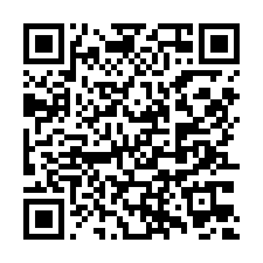
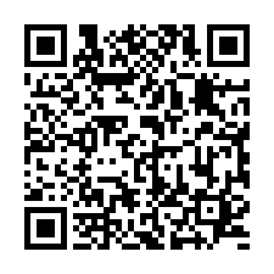

# 🚀 3DS-Drop — Transferencia de Alta Velocidad (PC ⇄ Nintendo 3DS y 2DS)

> **Creado y desarrollado por [ElVichoPo (@vicente134)](https://github.com/vicente134)**  
> ⭐ **¿Te sirvió 3DS-Drop para pasar tus juegos, música o partidas? ¡No olvides dejarle una Estrella (Star) arriba a la derecha en GitHub para apoyar el proyecto!** ⭐

---

**3DS-Drop** es un sistema completo de transferencia directa de archivos y carpetas en red local (Wi-Fi) entre **PC (Windows, Linux y macOS)** y **toda la familia de consolas Nintendo 3DS y 2DS** (`Nintendo 2DS`, `Old 3DS`, `Old 3DS XL`, `New 3DS`, `New 3DS XL` y **`New 2DS XL`**).

A diferencia de los clientes FTP tradicionales:
- 📡 **Detección 100% Automática (Zero-Config):** Abres el programa en tu PC y en tu consola (conectados al mismo Wi-Fi) y se detectan solos al instante, mostrando el modelo exacto de tu consola y el espacio libre de tu microSD.
- 💻 **Interfaz Limpia de Doble Panel:** Ves tus carpetas de tu PC a la izquierda y las carpetas de la microSD de tu 3DS / 2DS a la derecha. Solo seleccionas o arrastras lo que quieras pasar.
- ⚡ **Optimizado para Archivos Pesados (`.cia`, ROMs, música, backups):** Buffer de red de **1 MB** y escritura acumulada en RAM de **128 KB** para cuidar y acelerar al máximo la tarjeta microSD (más modo **Turbo 804 MHz** automático en consolas *New*).
- 🎵 **Interfaz Gráfica 2D/3D y Música de Transferencia:** Incluye sonido propio en el Menú HOME de la consola y una melodía relajante que suena mientras se transfieren tus archivos.

---

## 🎮 PASO 1: Instalar `3DS-Drop` en tu Nintendo 3DS o 2DS

Tienes **3 formas muy fáciles** de instalar la aplicación en tu consola:

### Opción A: 📷 Códigos QR Permanentes (No caducan nunca)

Estos códigos QR están alojados directamente en GitHub Releases y **funcionan para siempre**:

| 📦 Instalar en el Menú HOME (`.CIA` con FBI) | 🎮 Para The Homebrew Launcher (`.3DSX`) |
| :---: | :---: |
|  |  |
| **En tu consola:** Abre **FBI** $\rightarrow$ `Remote Install` $\rightarrow$ `Scan QR Code` y apunta a este QR. | Descarga `3DS-Drop.3dsx` directamente en tu consola. |

---

### Opción B: 📡 Enviar por Wi-Fi desde tu PC con `3dslink` (Sin sacar la microSD)

1. En tu 3DS / 2DS, abre **The Homebrew Launcher** y presiona el botón **`Y`** (*NetLoader*).
2. En tu PC, ejecuta el script automático incluido en este repositorio (detecta la IP de tu consola solo y le envía `3DS-Drop.3dsx` guardándolo en tu tarjeta SD):
   ```bash
   python3 send_to_3ds.py
   ```
   *(O si ya tienes `3dslink` instalado: `3dslink -a <IP_DE_TU_3DS> 3ds-homebrew/3DS-Drop.3dsx`)*.

---

### Opción C: 💾 Descarga Directa a tu Tarjeta microSD

- 📦 [**Descargar `3DS-Drop.cia` (Enlace Directo)**](https://github.com/vicente134/3DS-Drop/releases/latest/download/3DS-Drop.cia) $\rightarrow$ Cópialo a `/cias/` e instálalo con **FBI**.
- 🎮 [**Descargar `3DS-Drop.3dsx` (Enlace Directo)**](https://github.com/vicente134/3DS-Drop/releases/latest/download/3DS-Drop.3dsx) $\rightarrow$ Cópialo a `/3ds/` y ábrelo desde **The Homebrew Launcher**.

---

## 💻 PASO 2: Instalar `3DS-Drop` en tu PC (Windows, Linux y macOS)

### Opción 1: Descargar Ejecutable Directo (Sin instalar nada)
Ve a la sección de [**Releases Oficiales en GitHub**](https://github.com/vicente134/3DS-Drop/releases/latest) y descarga el archivo para tu sistema operativo:
- 🪟 **Windows:** [**Descargar `3DS-Drop-Windows.exe`**](https://github.com/vicente134/3DS-Drop/releases/latest/download/3DS-Drop-Windows.exe) *(Doble clic y listo)*.
- 🐧 **Linux:** [**Descargar `3DS-Drop-Linux-x86_64`**](https://github.com/vicente134/3DS-Drop/releases/latest/download/3DS-Drop-Linux-x86_64) *(Hazlo ejecutable y ábrelo)*.
- 🍎 **macOS:** [**Descargar `3DS-Drop-macOS.zip`**](https://github.com/vicente134/3DS-Drop/releases/latest/download/3DS-Drop-macOS.zip) *(Descomprime `3DS-Drop.app` y ábrelo)*.

---

### Opción 2: Instalador Automático de 1 Clic (Crea el ícono en tu Escritorio / Menú de Apps)
Si descargaste o clonaste este repositorio (`git clone https://github.com/vicente134/3DS-Drop.git`), incluye instaladores automáticos que dejan el programa como una aplicación nativa en tu sistema (para no usar nunca la terminal):

- 🪟 **En Windows:** Haz doble clic sobre **`Instalar_Windows.bat`**. Creará automáticamente el acceso directo **`3DS-Drop`** en tu Escritorio.
- 🐧 **En Linux (Arch / Omarchy / Ubuntu / Fedora):** Ejecuta una sola vez `./install_linux.sh`. Instalará la app con su ícono en tu menú de aplicaciones del sistema (`Super + Espacio` $\rightarrow$ **3DS-Drop**).
- 🍎 **En macOS:** Haz doble clic sobre **`install_macos.command`**. Creará la aplicación **`3DS-Drop.app`** en tu carpeta de Aplicaciones.

---

## 📖 Cómo Usar `3DS-Drop` Paso a Paso

1. **Conecta ambos a la misma red:** Asegúrate de que tu **Nintendo 3DS / 2DS** y tu **PC** estén conectados a la misma red local (el mismo router de tu casa o la zona Wi-Fi de tu celular).
2. **Abre `3DS-Drop` en tu consola:** Verás en la pantalla superior el modelo de tu consola, tu dirección IP en color verde y el espacio libre de tu microSD.
3. **Abre `3DS-Drop` en tu PC:**
   - En menos de 2 segundos, la barra superior cambiará a verde: **`● Conectada: <Tu Consola> (<IP>)`** y a la derecha aparecerán todas las carpetas de tu tarjeta microSD.
   - *(Si tu router Wi-Fi tiene aislamiento estricto, siempre puedes hacer clic en el botón **`Conectar por IP`** arriba a la derecha y escribir la IP que muestra tu consola).*
4. **Transfiere archivos o carpetas completas:**
   - **De tu PC a la 3DS / 2DS:** En el panel izquierdo (**`💻 Tu PC`**) selecciona cualquier archivo (`.cia`, `.3dsx`, `.nds`, `.mp3`) o carpeta completa y haz clic en **`Enviar seleccionado a la 3DS / 2DS ➔`** (o simplemente arrástralo con el mouse hacia el panel derecho).
   - **De la 3DS / 2DS a tu PC:** En el panel derecho (**`🎮 Nintendo 3DS / 2DS`**) selecciona el archivo o carpeta que quieras respaldar y haz clic en **`⬅ Guardar en tu PC`**.
   - **Organizar tu microSD:** Usa los botones **`📁 Nueva Carpeta`** o **`🗑️ Eliminar`** directamente desde el panel derecho.

---

## 🕹️ Controles en la Consola Nintendo 3DS / 2DS

| Botón / Pantalla Táctil | Función |
| :--- | :--- |
| **`Y`** o botón táctil **`♪ MUSICA`** | Activa o desactiva la música relajante durante las transferencias. |
| **`SELECT`** o botón táctil **`PANTALLA OFF`** | Apaga o enciende la luz de las pantallas para ahorrar batería durante descargas grandes (la transferencia sigue activa aunque cierres la tapa). |
| **`START`** | Cierra `3DS-Drop` y regresa al Menú HOME / Homebrew Launcher. |

---

## ❤️ Créditos

- **Autor y Creador:** **ElVichoPo** ([@vicente134](https://github.com/vicente134))
- ⭐ **¡Si te gusta `3DS-Drop`, regálale una estrella (`Star`) al repositorio en GitHub!**
